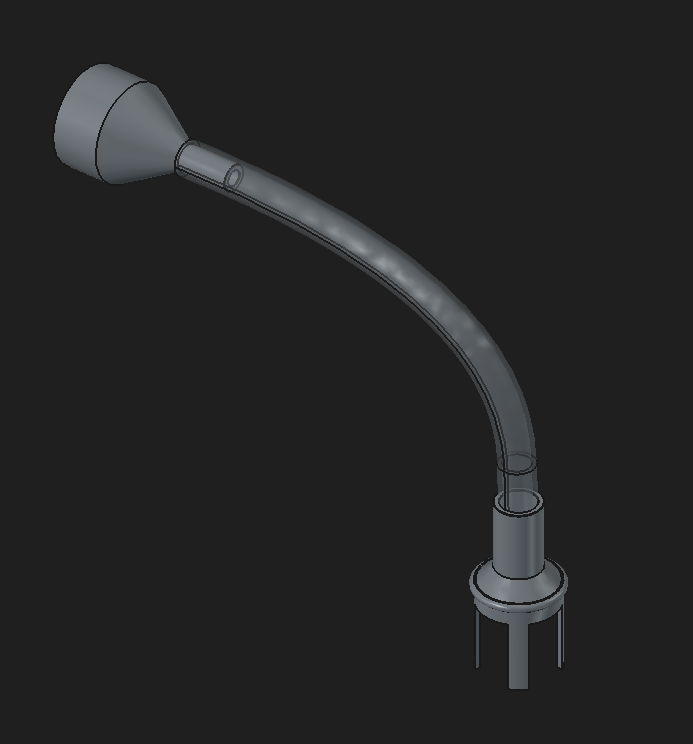
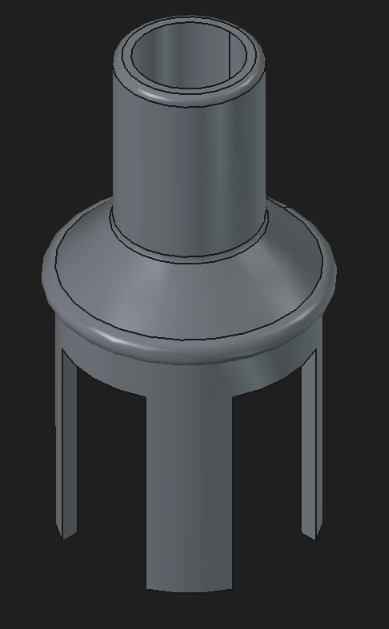
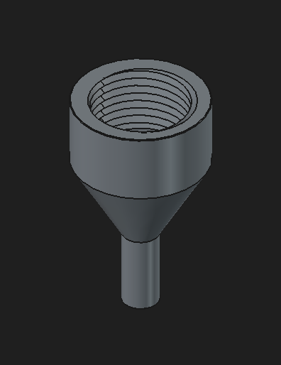

# Purpose/Background

Having a dehumidifier that you have to constantly pay attention to emptying is tedious. Personally, I had to empty mine out twice a day, so I ordered a condensate pump from Amazon. 

Most dehumidifiers use a 3/4 GHT thread for a garden hose that you can use to carry water out of the bucket, however, my condensate pump (The "Little Giant VMCA-15ULST") came with 1/2 inch tubing (3/8in ID). I didn't want to spend more money on this, so these adapters go into the dehumidifier and to the other end of the tube while using the same 1/2 inch tubing. 

# BOM
- Any dehumidifier that uses a 3/4 GHT hose port for external drainage. 
- Little Giant VCMA-15ULST Condensate pump. Other condensate pumps are compatable if they use the same deposit port size and have 1/2 inch tubing. 

# Assembly
- Cut the 1/2 inch tube to whatever size you need, and put the adapters on both ends. They should just slide on and hold tight with friction. 

# 3D Printing
- If you are 3D printing this, use more walls than you usually need, and maybe bump up the flow a bit. Especially for the 3/4GHT to 1/2 tube part. Ideally you want it water tight, but you can also use some sort of sealant if you would like. I did not find this necessary.
- No supports needed. Print "Little Giant" upside down, and use a brim if you are having trouble with bed adhesion or a fast bed slinger.  

# Images
## CAD Images

### Assembly

### "Little Giant" piece

### "3/4GHT to 1/2 Tubing" Piece

## Real World Images

Will add in future